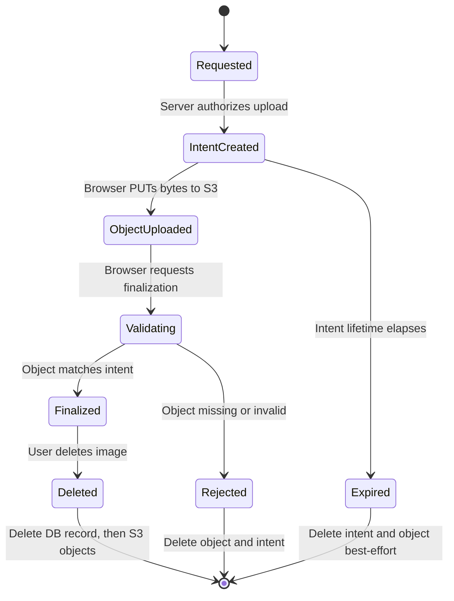
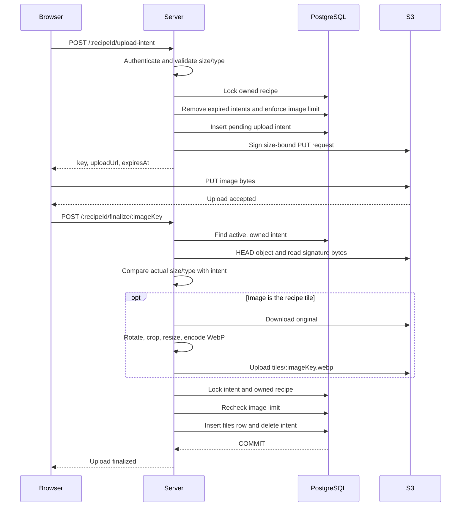

# File Upload and S3 Flow

## System boundaries

- The browser uploads image bytes directly to S3.
- The server authorizes uploads, records their expected metadata, validates the
  resulting S3 object, and makes finalized files visible to the application.
- PostgreSQL is the source of truth for file ownership and lifecycle state.
- S3 is the source of truth for object bytes.

## Upload state machine

A file is usable by the application only after it has moved from
`pending_file_uploads` to `files`.

## New upload sequence

## Upload intent

`POST /:recipeId/upload-intent`

1. Authentication establishes `userID`.
2. The server validates the recipe ID, declared byte size, and declared MIME
   type against shared upload constraints.
3. A transaction locks the owned recipe, removes the user's expired intents,
   and counts finalized plus active pending images.
4. The server inserts a `pending_file_uploads` row with a random object key,
   expected metadata, owner, recipe, and ten-minute expiration.
5. The server returns a five-minute presigned S3 PUT URL.
6. If URL signing fails, the pending intent is removed.

The intent reserves capacity and binds one object key to one user, recipe,
expected size, and expected content type. It is authorization to attempt an
upload, not proof that a valid file exists.

## Finalization

`POST /:recipeId/finalize/:imageKey`

1. The server finds an unexpired intent owned by the authenticated user.
2. S3 `HeadObject` supplies the actual byte count.
3. A ranged `GetObject` supplies enough bytes to detect the file type from its
   contents rather than trusting request headers or the file extension.
4. Actual size and detected type must match the intent and server constraints.
5. If `isTile` is true, the server creates the optimized tile before committing
   the file record.
6. A transaction locks the intent and recipe, rechecks the recipe image limit,
   inserts the finalized `files` row, and consumes the intent.
7. On validation or finalization failure, the original object, generated
   thumbnail, and pending intent are cleaned up where applicable.

The repeated checks prevent an expired intent, concurrent upload, or changed
recipe state from bypassing authorization or image-count limits.

## Tile image lifecycle

### Finalizing a new tile

When `isTile` is true, finalization creates `tiles/:imageKey.webp` and stores
that key in `files.thumbnail_key`. The original remains available for recipe
detail views.

### Selecting an existing image as the tile

`POST /tile-image/:awsKey/:recipeId`

1. Verify that the file belongs to both the user and recipe.
2. Reuse its thumbnail or generate one if absent.
3. Lock the recipe and update the file thumbnail and
   `recipes.default_tile_image_key` atomically.
4. Detach the previous tile's thumbnail in the same transaction.
5. Delete the previous thumbnail from S3 after commit.

If the transaction fails, a newly generated thumbnail is deleted.

### Removing the tile designation

`DELETE /tile-image/:recipeId`

1. Lock the owned recipe.
2. Clear `recipes.default_tile_image_key` and the file's `thumbnail_key`.
3. Commit the database changes.
4. Delete the thumbnail from S3 best-effort.

The original image remains finalized and usable.

## File reads

`POST /`

The server accepts an array of image keys, verifies every key belongs to the
authenticated user, then returns short-lived presigned GET URLs. Unknown or
foreign keys cause the entire request to fail.

## File deletion

`DELETE /:imageKey`

1. Lock the owned file.
2. Clear the recipe tile reference if it points to that file.
3. Delete the `files` row and commit.
4. Delete the original and thumbnail objects from S3 best-effort.

Database deletion happens first so a failed S3 cleanup cannot leave a deleted
file accessible through the application. A failed S3 deletion can leave an
orphaned object and should be observable and retried by operational tooling.

## Consistency rules

- Never create a finalized `files` row before validating the S3 object.
- Never trust client-provided MIME type, size, ownership, or object key alone.
- Recheck mutable constraints inside the transaction that commits the change.
- Keep database changes atomic; perform S3 cleanup after commit when possible.
- Treat cross-system cleanup as best-effort because PostgreSQL and S3 cannot
  share one transaction.
- Store immutable S3 keys, and issue expiring URLs only after authorization.
- Preserve originals; create optimized variants only for presentation contexts
  that need them.
